---
# Internal showcase — must stay a draft (only visible with `hugo server -D`)
draft: true
title: "Mermaid Demo"
lead: "Diagram ideas for existing and future posts"
commentid: "mermaid-demo"
description: "Internal showcase of Mermaid diagrams for the Robotmk blog."
date: "2026-11-12T12:00:00+01:00"
categories:
  - background
tags:
  - internal
authorbox: false
sidebar: false
pager: false
---

Internal page: never publish. Every diagram below is a ```` ```mermaid ```` code fence and can be copied into a post as-is.

**Part 1** contains diagrams derived from existing posts. They use only names, commands and steps that appear in the respective article.
**Part 2** contains fresh ideas with diagram types the blog doesn't use yet. Numbers marked *illustrative* are made up and must be replaced with real data.

Syntax tips:
- Line break in a label: `<br/>`
- Literal `<` / `>` / `"` in a label: `#lt;` / `#gt;` / `#quot;`
- Quote any label containing special characters: `A["label (x)"]`

---

## Part 1: Diagrams for existing posts

### Robotmk v2 quick start (`getting-started`)

**Where:** "TL'DR – what is this actually about?". Shows the four Robotmk components and what flows between them.

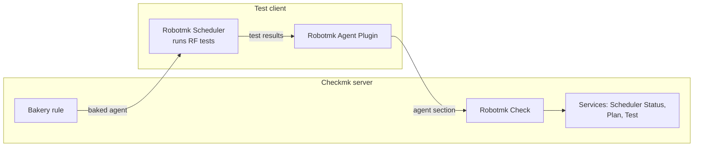

**Where:** "Discovery of services". Explains why the Plan and Test services only appear minutes after Scheduler Status.

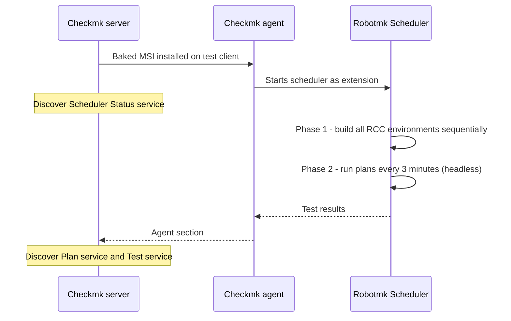

### Effortless Python Environments with RCC (`rcc-ultimate-tool`)

**Where:** "How RCC works". The Docker analogy side by side: Docker needs one description file, RCC needs two.

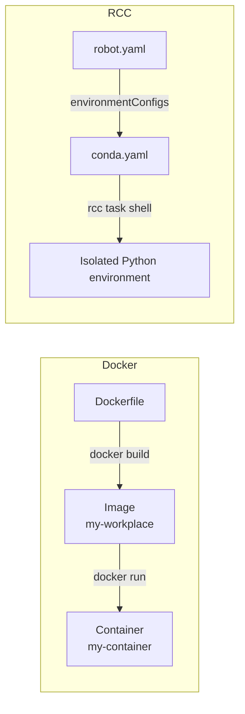

### RCC in air-gapped environments (`rcc-envoffline`)

**Where:** "The Solution: ZIP Archive". Which step runs on which machine, and where the ZIP crosses the air gap.

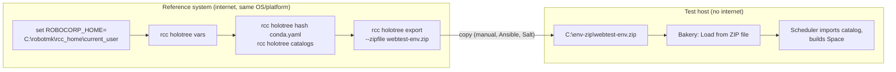

### RCC Environments and their Supply Chain (`rcc-env-supplychain`)

**Where:** "The six-step recipe", after "The Big Picture". The recipe is a loop: step 5 can send you back to the build.

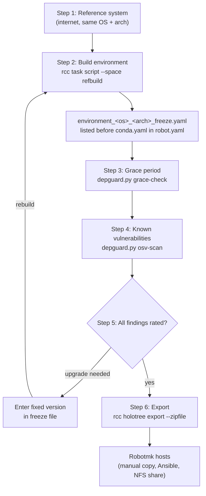

**Where:** "Step 5 – Evaluate and decide". Each finding passes through a filter, and CVSS comes last.

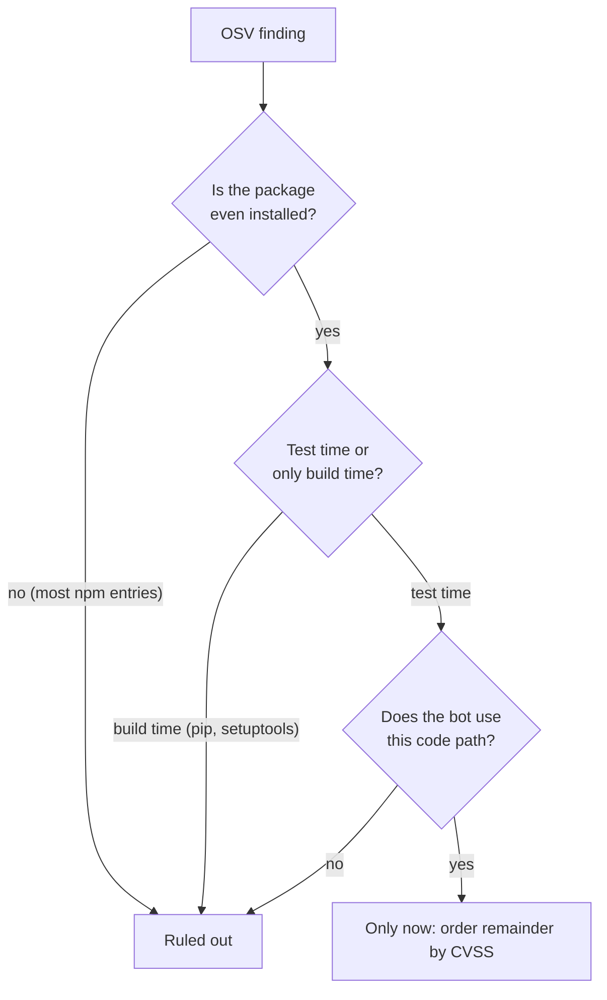

### RCC in the CMK Root Agent (`rcc-root-agent-werks`)

**Where:** at the top, before "Act 1". Three seemingly contradictory werks read as one progression.

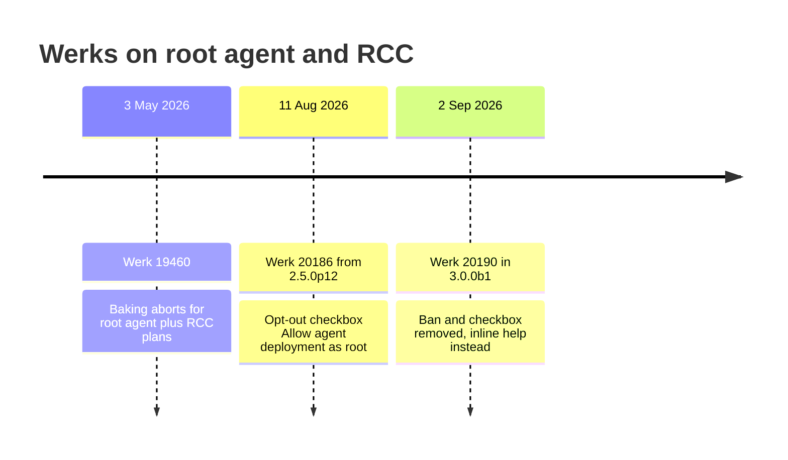

**Where:** "What does this mean for you?". Turns the version list into a "which case am I?" lookup.

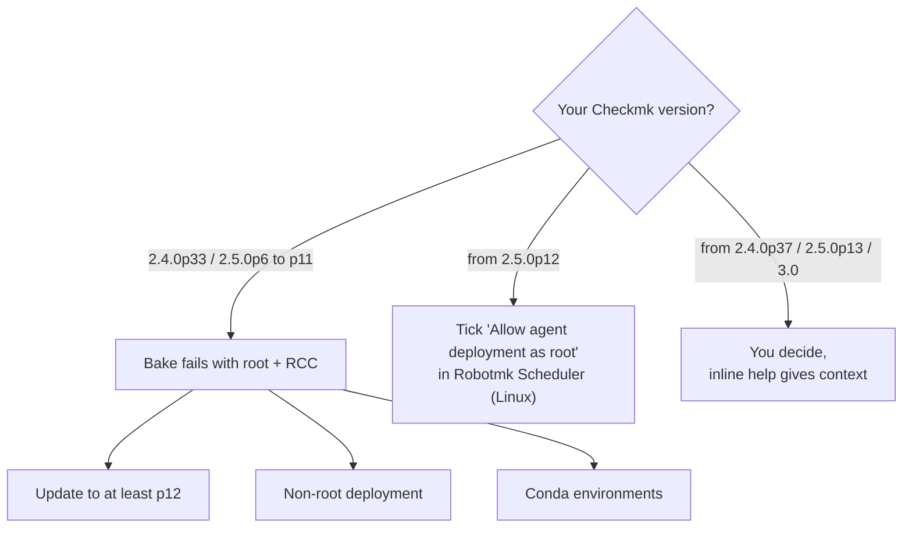

### RCC Troubleshooting (`rcctrouble`)

**Where:** "Environment creation". Maps an error message directly to its fix.

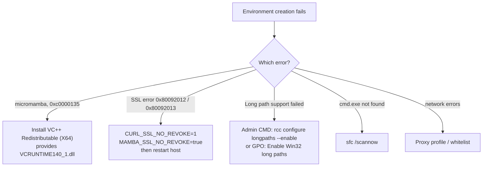

### Understanding and Applying Proxy Settings (`proxies-test`)

**Where:** "The results", after the table. Proxy precedence of both libraries side by side.

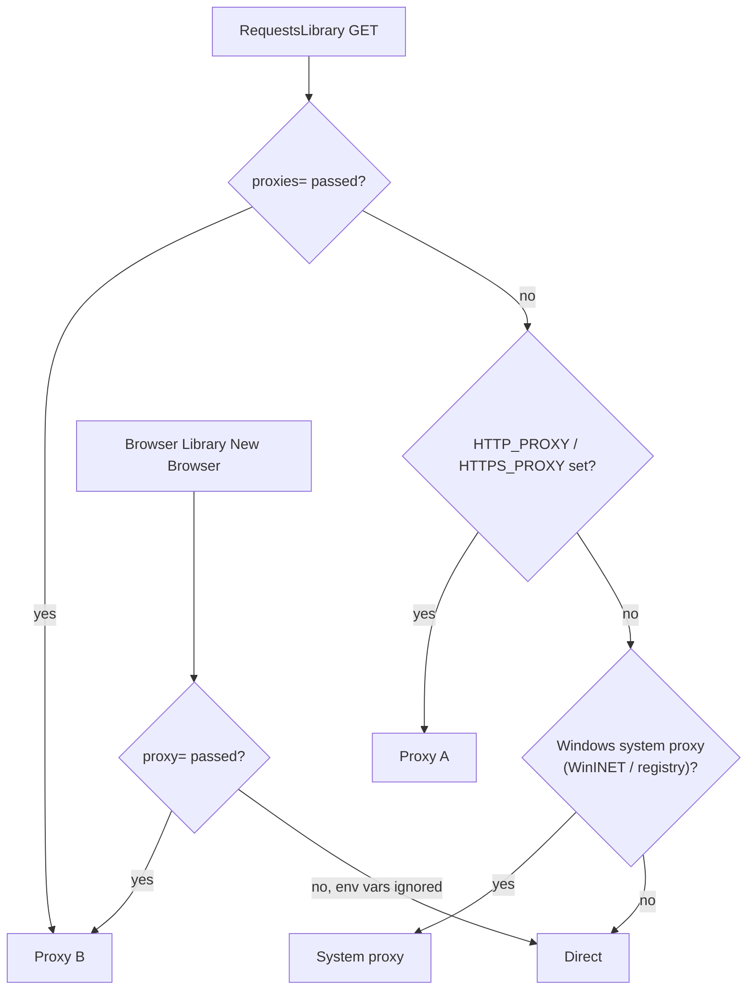

**Where:** "The invisible connection: gRPC and NO_PROXY". Shows the third, local connection most people never notice.

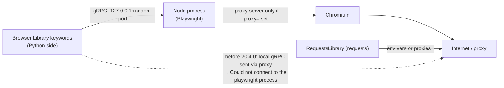

### CryptoLibrary (`cryptolibrary`)

**Where:** "Generating the Key Pair and Encrypting Secrets". Key and ciphertext travel through Git, but the password that unlocks them never does.

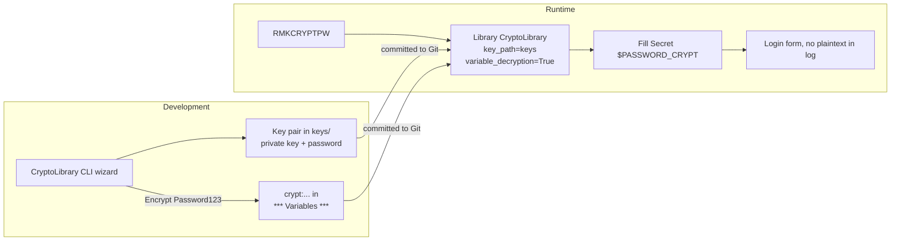

### Game Changer: Secret Variables (`secretvars`)

**Where:** "How do I access secrets?". Three sources, a protected path, and the one place where the protection breaks.

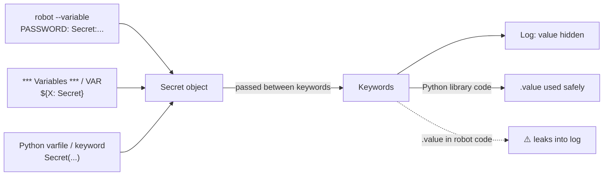

### Robotmk Starter (`rmk-starter`)

**Where:** "Three Ways to Try It Out". Readers pick a path instead of reading all three sections.

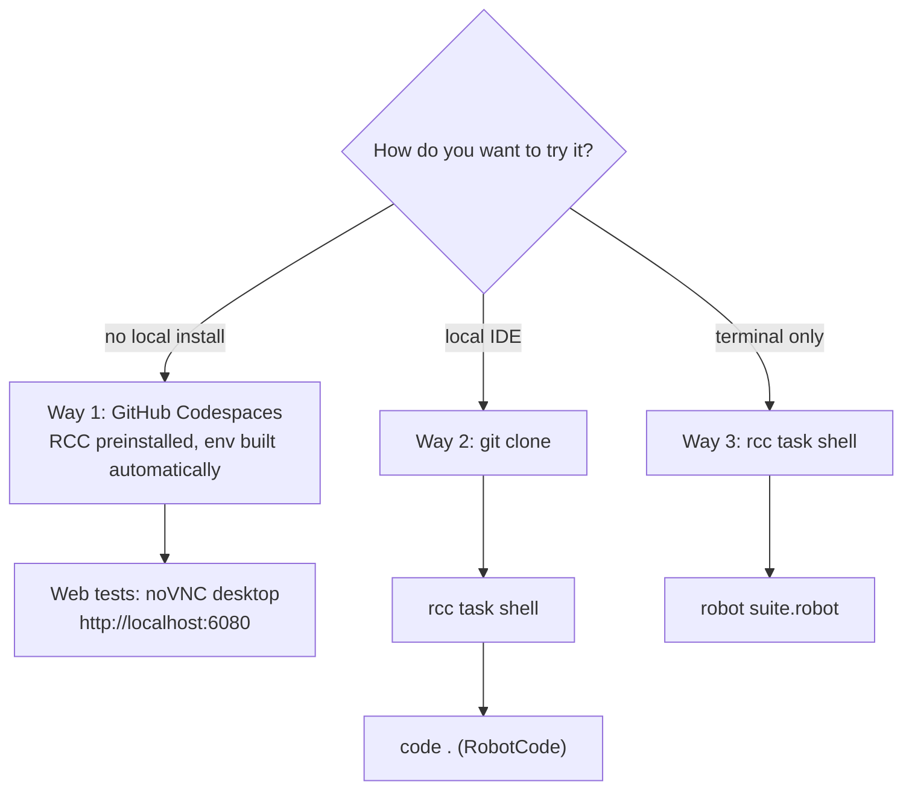

### Robust selectors (`web-selectors`)

**Where:** "Accessible Name: Background". The browser takes the first source that exists.

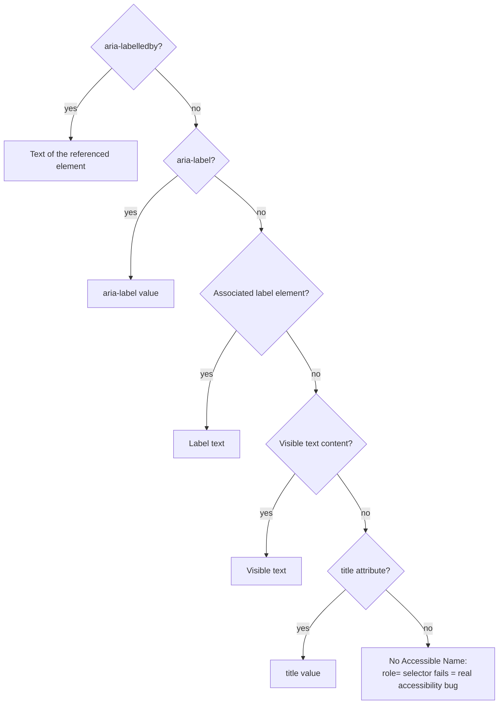

**Where:** "In conclusion: The selector ranking". The ranking as a fallback chain.

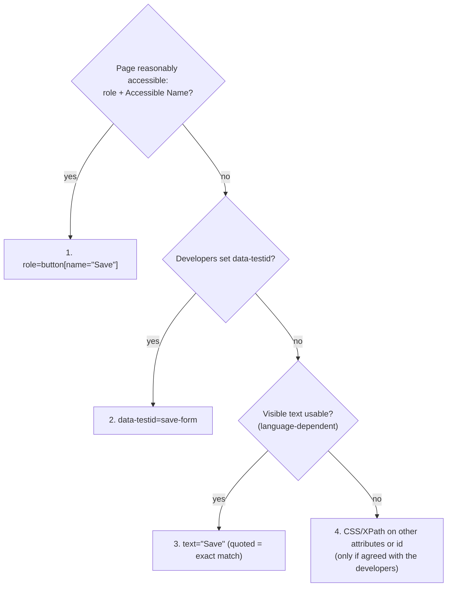

### Accessible Name selectors (`web-selectors-2`)

**Where:** "What I've learnt from this case". The four-question check as a procedure.

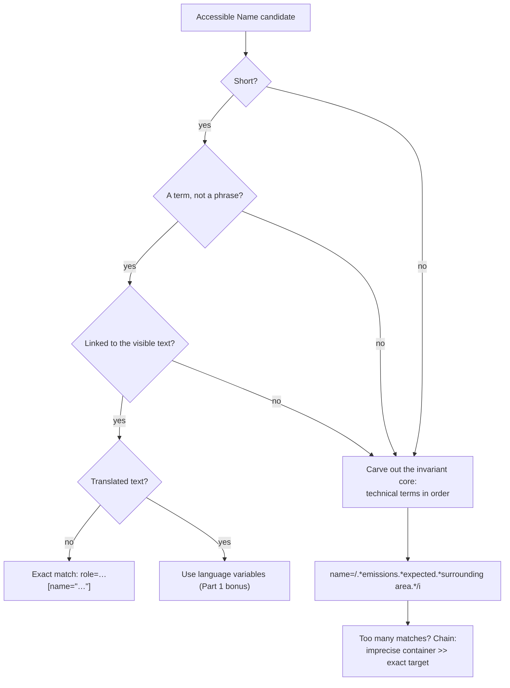

### Edge detection for the ImageHorizonLibrary (`ihl-skimage-pr`)

**Where:** "The strategy edge". The edge strategy only adds a preprocessing step, and `confidence` still applies to both paths.

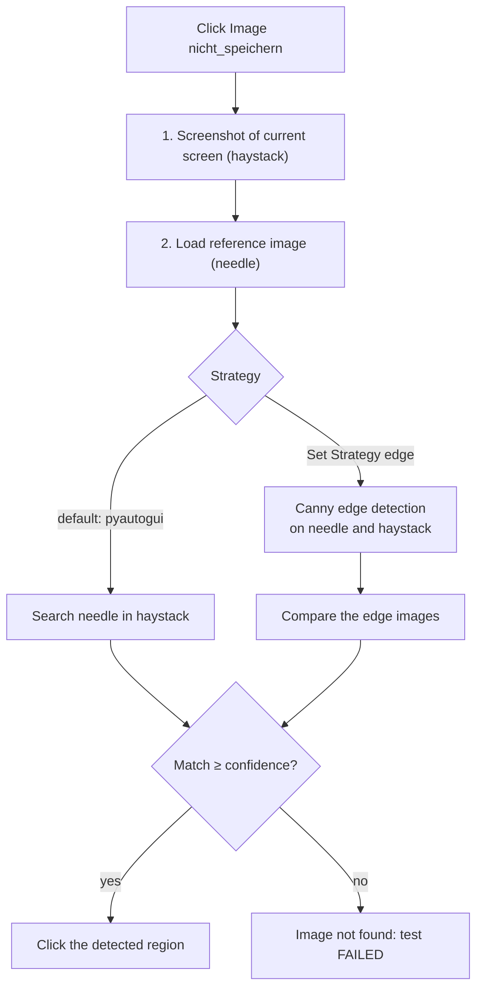

**Where:** "Canny edge detection in a nutshell". The five steps as a pipeline.

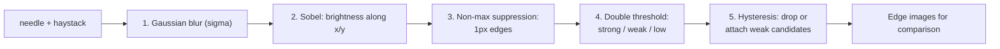

### RF-MCP starter (`rf-mcp-starter`)

**Where:** "MCP: The 'USB standard' for AI tools". The feedback loop that chat mode doesn't have.

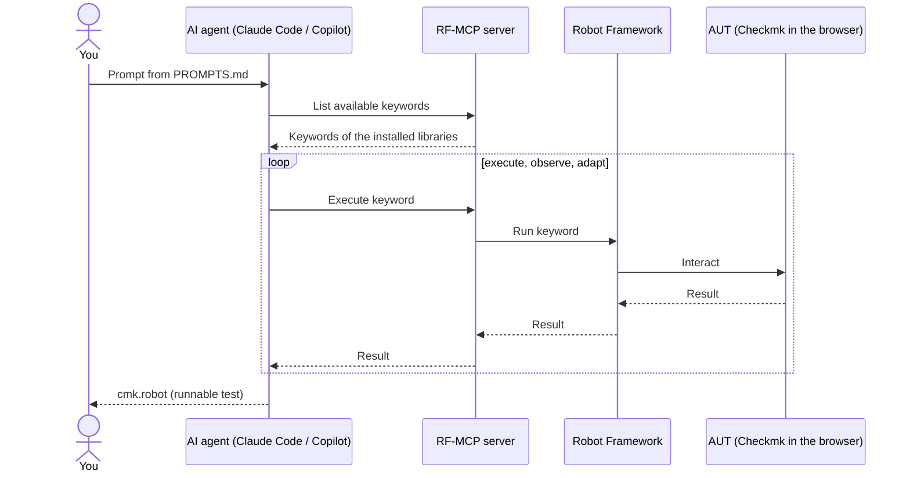

### The Helsinki shortcut (`vscode-helsinki-shortcut`)

**Where:** after "The solution". The restart loop next to the loop inside one paused debug session.

```mermaid
flowchart TD
    subgraph OLD["Without the shortcut: stop-and-go"]
        O1["Write keyword"] --> O2["Run test, wait for the browser"]
        O2 --> O3{"Works?"}
        O3 -- no --> O4["Abort, correct, restart"]
        O4 --> O2
    end
    subgraph NEW["Helsinki shortcut"]
        N1["Breakpoint, e.g. on No Operation"] --> N2["Debug Test: execution pauses"]
        N2 --> N3["Write keyword in the editor"]
        N3 --> N4["Alt+D: Evaluate in Debug Console"]
        N4 --> N5["See the result in the browser immediately"]
        N5 -- "next or corrected keyword" --> N3
    end
```

### RoboCon 2026 recap, day 1 (`robocon26-recap-2`)

**Where:** "Medusa: Resource-aware parallel suite execution". Stages run sequentially, suites within a stage in parallel.

```mermaid
flowchart TD
    M["Medusa: wrapper around Robot Framework,<br/>passes on Robot options"] --> META["Each suite declares metadata:<br/>resource dependencies + stage"]
    META --> S1
    subgraph S1["Stage 1"]
        P1["Suites start in parallel<br/>without resource conflicts"]
    end
    subgraph S2["Stage 2"]
        P2["Suites start in parallel<br/>without resource conflicts"]
    end
    S1 -- "stages run sequentially" --> S2
    S2 --> R["rebot merges the results of all suites"]
```

### Browser Batteries (`browser-batteries`, German draft)

**Where:** "Was tatsächlich verschwindet: npm". Two package sources disappear, and the browser binaries still come from the CDN.

```mermaid
flowchart LR
    subgraph VORHER["Bisher: nodejs + rfbrowser init"]
        direction TB
        CF["conda-forge: nodejs"] --> E1["RCC-Environment"]
        PY1["PyPI: robotframework-browser"] --> E1
        NPM["npm-Registry: ~85 Pakete"] -- "rfbrowser init" --> E1
        CDN1["CDN: Browser-Binaries"] -- "rfbrowser init" --> E1
    end
    subgraph NACHHER["Mit Batteries: [bb]"]
        direction TB
        PY2["PyPI: robotframework-browser[bb]<br/>ein Wheel inkl. NodeJS + node_modules"] --> E2["RCC-Environment"]
        CDN2["CDN: Browser-Binaries"] -- "rfbrowser install" --> E2
    end
```

**Where:** "Spart das Platz?". A bar chart instead of two numbers in the prose (file counts taken from the draft).

```mermaid
xychart-beta
    title "Dateien im RCC-Environment"
    x-axis ["nodejs + npm", "Batteries [bb]"]
    y-axis "Dateien" 0 --> 5000
    bar [4780, 2853]
```

---

## Part 2: Fresh ideas

### The Robotmk architecture at a glance

A reusable "big picture" for every post that has to explain where things run. Uses `architecture-beta`.

```mermaid
architecture-beta
    group site(cloud)[Checkmk site]
    group host(server)[Test host]

    service bakery(server)[Agent Bakery] in site
    service check(database)[Robotmk Check] in site
    service agent(server)[Checkmk Agent] in host
    service sched(server)[Robotmk Scheduler] in host
    service rcc(disk)[RCC Holotree] in host
    service app(internet)[Application under test]

    bakery:R --> L:agent
    check:R <-- B:agent
    agent:R --> L:sched
    sched:B --> T:rcc
    sched:R --> L:app
```

### A day in the life of the Scheduler

Makes plan intervals and the environment build phase tangible, for example for a post on plan design. *Illustrative timings.*

```mermaid
gantt
    title Robotmk Scheduler (illustrative)
    dateFormat HH:mm
    axisFormat %H:%M
    section Phase 1
    Build RCC environments      :done, env, 08:00, 6m
    section Plan web-shop (3 min)
    Run 1                       :p1, after env, 1m
    Run 2                       :p2, 08:09, 1m
    Run 3                       :p3, 08:12, 1m
    Run 4                       :p4, 08:15, 1m
    section Plan SAP GUI (5 min)
    Run 1                       :s1, after env, 3m
    Run 2                       :crit, s2, 08:11, 3m
    Run 3                       :s3, 08:16, 3m
```

### From robot result to Checkmk state

A state diagram for a post on thresholds and service states (the exact rules depend on the configured thresholds).

```mermaid
stateDiagram-v2
    direction LR
    [*] --> Scheduled
    Scheduled --> Running: interval reached
    Running --> PASS
    Running --> FAIL
    PASS --> OK: runtime below thresholds
    PASS --> WARN: runtime above WARN
    PASS --> CRIT: runtime above CRIT
    FAIL --> CRIT
    OK --> Scheduled
    WARN --> Scheduled
    CRIT --> Scheduled
```

### Selector types: robustness vs. readability

A summary chart for the selector series. *Positions are an opinion, matching the ranking in Part 1.*

```mermaid
quadrantChart
    title Web selectors
    x-axis Hard to read --> Easy to read
    y-axis Fragile --> Robust
    quadrant-1 Use these
    quadrant-2 Robust but cryptic
    quadrant-3 Avoid
    quadrant-4 Readable but brittle
    Absolute XPath: [0.10, 0.10]
    CSS class chain: [0.30, 0.30]
    text exact: [0.78, 0.38]
    data-testid: [0.55, 0.80]
    role + Accessible Name: [0.85, 0.85]
    name regex: [0.60, 0.70]
```

### The newcomer journey

Shows where it hurts on the way from the first robot to the first alert, e.g. as the intro of a "Getting started, revisited" post. *Scores illustrative (1 = painful, 5 = smooth).*

```mermaid
journey
    title From first robot to first alert
    section Develop
      Install RCC: 3: Developer
      Write first suite: 4: Developer
      rcc task shell + robot: 5: Developer
    section Deploy
      Bakery rule: 3: Checkmk admin
      Bake and install agent: 4: Checkmk admin
    section Operate
      Service discovery: 5: Checkmk admin
      First CRIT alert: 5: Developer, Checkmk admin
```

### The Robotmk ecosystem as a mind map

A navigation aid for the blog or the start page, built only from topics the blog already covers.

```mermaid
mindmap
  root((Robotmk))
    Checkmk
      Agent Bakery
      Scheduler
      Robotmk Check
    RCC
      Holotree
      Offline ZIP
      Supply chain
      Proxies
    Libraries
      Browser Library
      ImageHorizonLibrary
      CryptoLibrary
      RequestsLibrary
    Tooling
      RobotCode
      RF-MCP
      Robotmk Starter
```

### Runtime trend with thresholds

A line chart for a post on performance monitoring with Robotmk. *Illustrative data.*

```mermaid
xychart-beta
    title "Test runtime in seconds (illustrative)"
    x-axis [Mon, Tue, Wed, Thu, Fri, Sat, Sun]
    y-axis "seconds" 0 --> 30
    line [12, 13, 12, 18, 24, 14, 12]
    line [20, 20, 20, 20, 20, 20, 20]
    line [25, 25, 25, 25, 25, 25, 25]
```

### Where the OSV findings end up

A Sankey diagram as the punchline of the supply chain post's step 5. *Illustrative numbers. Replace them with a real scan.*

```mermaid
sankey-beta
OSV findings,Not installed,60
OSV findings,Installed,40
Installed,Build time only,18
Installed,Test time,22
Test time,Code path unused,14
Test time,Rate by CVSS,8
```

### The freeze file as a Git workflow

How the supply chain recipe could look in Git, e.g. for a follow-up post. *Illustrative.*

```mermaid
gitGraph
    commit id: "conda.yaml"
    branch refbuild
    checkout refbuild
    commit id: "freeze.yaml"
    commit id: "grace-check ok"
    commit id: "osv-scan: fix pin"
    checkout main
    merge refbuild tag: "env-2026-11"
    commit id: "holotree export"
```
